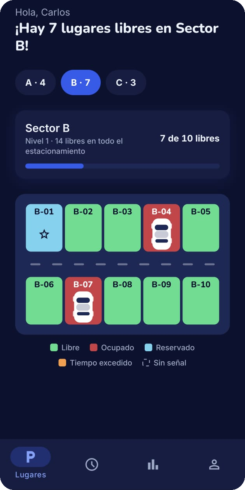
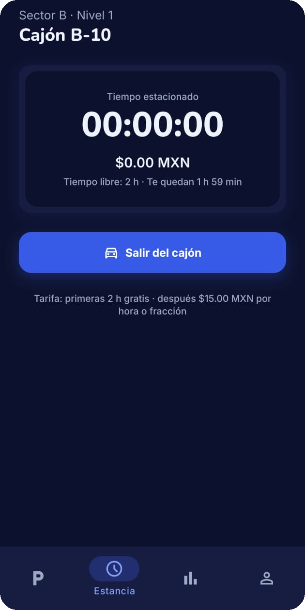
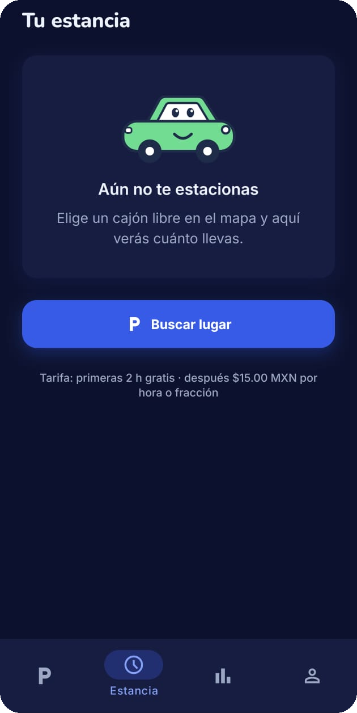
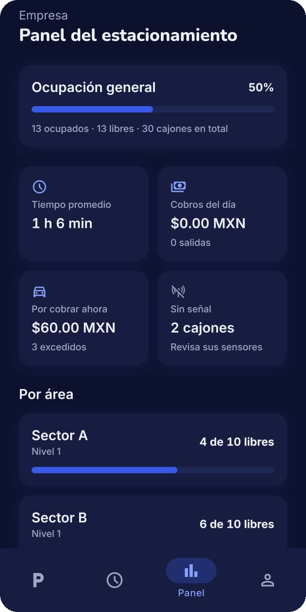
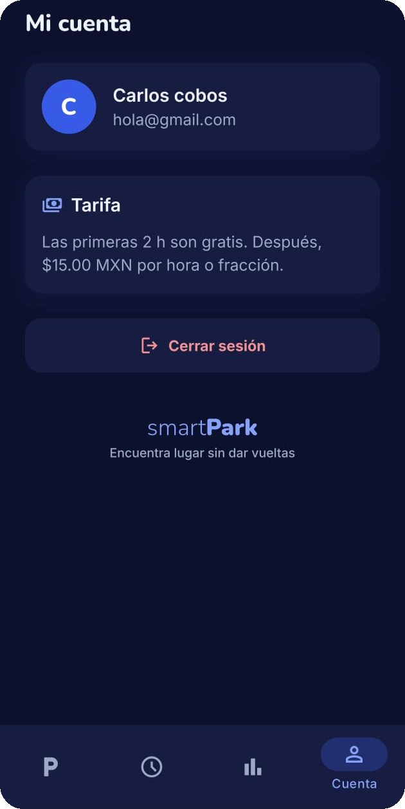
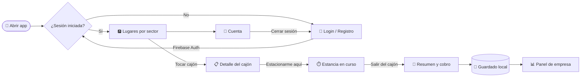

<div align="center">


# smart**Park**

**Encuentra lugar sin dar vueltas.**
App Android para ver los cajones libres de un estacionamiento, estacionarte, llevar la cuenta de tu tiempo y saber cuánto vas a pagar.

<br />


<br />
<br />

<a href="https://github.com/Ciitreck/SmartPark/releases/latest">
  
</a>

<sub>Descarga el archivo <code>.apk</code> de la última versión e instálalo en tu teléfono Android.</sub>

<br />
<br />

&nbsp;&nbsp;
&nbsp;&nbsp;


</div>

---

## 📋 Tabla de contenido

- [¿Qué es SmartPark?](#-qué-es-smartpark)
- [Capturas](#-capturas)
- [Funciones](#-funciones)
- [Estados de un cajón](#-estados-de-un-cajón)
- [Tarifa](#-tarifa)
- [Diseño](#-diseño)
- [Tecnologías](#️-tecnologías)
- [Cómo funciona](#-cómo-funciona)
- [Empezar](#-empezar)
- [Generar el APK](#-generar-el-apk)
- [Estructura del proyecto](#-estructura-del-proyecto)
- [Scripts](#-scripts)
- [Hoja de ruta](#️-hoja-de-ruta)

---

## 🚗 ¿Qué es SmartPark?

**SmartPark** muestra el estacionamiento como un mapa de cajones dividido en sectores. De un vistazo sabes cuántos lugares quedan libres y dónde están. Eliges un cajón, te estacionas y la app lleva la cuenta de tu tiempo y de lo que vas a pagar. Para la empresa hay un panel con la ocupación, los cobros del día y los sensores que no responden.

> 🎯 **Objetivo:** reducir el tiempo que se pierde buscando dónde estacionarse.

---

## 📸 Capturas

<div align="center">

| 🔐 Inicio de sesión | 🅿️ Lugares | ⏱️ Estancia |
|:-:|:-:|:-:|
|  |  |  |
| Correo y contraseña con Firebase, con botón para ver la contraseña. | Sectores con lugares libres, mapa de cajones y leyenda de colores. | Antes de estacionarte: la mascota te invita a buscar lugar. |

| 🚙 Estancia en curso | 📊 Panel de empresa | 👤 Cuenta |
|:-:|:-:|:-:|
|  |  |  |
| Cronómetro en vivo, costo acumulado y tiempo libre restante. | Ocupación, tiempo promedio, cobros y sensores sin señal. | Tus datos, la tarifa vigente y cerrar sesión. |

</div>

---

## ✨ Funciones

### Para quien se estaciona

| | Función | Detalle |
|:-:|---|---|
| 🔐 | **Cuenta propia** | Registro e inicio de sesión con correo y contraseña (Firebase). Mensajes de error claros y en español. |
| 🗺️ | **Lugares por sector** | 30 cajones en los sectores A, B y C. Cada botón dice cuántos libres tiene (`A · 4`, `B · 7`…) y la app abre en el que tiene más. |
| 📊 | **Disponibilidad al instante** | Tarjeta con "7 de 10 libres", una barra de ocupación y el total de libres en todo el estacionamiento. |
| 📋 | **Detalle del cajón** | Al tocar un cajón sube una hoja con su número, sector, estado, tiempo y costo, y el botón **"Estacionarme aquí"**. |
| ⏱️ | **Tu estancia** | Cronómetro `00:00:00`, lo que llevas a pagar y cuánto tiempo gratis te queda. Un aviso en *Lugares* te recuerda dónde estás. |
| 🧾 | **Resumen al salir** | Al tocar **"Salir del cajón"** ves cuánto tiempo estuviste y el total a pagar. |

### Para la empresa

| | Función | Detalle |
|:-:|---|---|
| 📈 | **Ocupación general** | Porcentaje de ocupación con ocupados, libres y total de cajones. |
| 🕐 | **Tiempo promedio** | Cuánto tiempo llevan, en promedio, los autos estacionados. |
| 💵 | **Cobros** | Lo cobrado en el día (con número de salidas) y lo que falta por cobrar a quienes ya excedieron el tiempo libre. |
| 📡 | **Sensores sin señal** | Cuántos cajones no reportan su estado, para revisarlos. |
| 🏢 | **Por área** | Lugares libres de cada sector con su barra de ocupación. |

### En toda la app

| | Función | Detalle |
|:-:|---|---|
| 🎨 | **Design system propio** | Colores, tipografías, espacios y componentes reutilizables. |
| 🌗 | **Modo claro y oscuro** | Sigue el tema del teléfono. |
| 🚙 | **Mascota y animaciones** | Carritos con cara, carros que entran al cajón y transiciones cortas sin rebote. |
| ⌨️ | **Teclado sin estorbar** | En Android la pantalla se desplaza al campo activo para que el teclado no lo tape. |
| 💾 | **Guarda todo** | Cajones, tu estancia y el historial de cobros se conservan aunque cierres la app. |

---

## 🚦 Estados de un cajón

| Color | Estado | Qué significa |
|:-:|---|---|
|  | **Libre** | Puedes estacionarte. |
|  | **Ocupado** | Hay un auto; muestra cuánto tiempo lleva. |
|  | **Reservado** | Para personas con discapacidad (♿) o preferente (⭐). |
|  | **Tiempo excedido** | Lleva más de 2 h: ya genera cobro. |
|  | **Sin señal** | El sensor del cajón no responde (se dibuja con borde punteado). |

---

## 💵 Tarifa

**Las primeras 2 horas son gratis.** Después se cobran **$15.00 MXN por hora o fracción**.

| Tiempo estacionado | Pagas |
|---|---:|
| 45 min | $0.00 MXN |
| 2 h | $0.00 MXN |
| 2 h 10 min | $15.00 MXN |
| 3 h 30 min | $30.00 MXN |
| 5 h | $45.00 MXN |

> La tarifa vive en [`src/lib/pricing.ts`](src/lib/pricing.ts) por si hay que ajustarla.

---

## 🎨 Diseño

<div align="center">


</div>

El logo es un **pin de ubicación con la "P"** de estacionamiento y un **punto verde** que indica *lugar libre*.

| Color | Hex | Uso |
|:-:|---|---|
|  | `#2A5BF0` | Azul de marca: botones, logo y selección |
|  | `#2ED47A` | Verde: cajones libres y disponibilidad |
|  | `#4FC6EA` | Cielo: cajones reservados |
|  | `#0B1230` | Fondo del modo oscuro |
|  | `#1B2B4B` | Texto y asfalto del modo claro |

**Tipografías:** [Nunito](https://fonts.google.com/specimen/Nunito) para títulos y el nombre *smart**Park***, e [Inter](https://fonts.google.com/specimen/Inter) para el texto.

Todos los valores están en [`src/constants/theme.ts`](src/constants/theme.ts), y los componentes base en [`src/components/ui/`](src/components/ui).

---

## 🛠️ Tecnologías

<div align="center">

| Capa | Herramienta |
|---|---|
| Framework | [Expo SDK 58](https://docs.expo.dev/) + [React Native 0.88](https://reactnative.dev/) |
| Lenguaje | TypeScript |
| Navegación | [Expo Router](https://docs.expo.dev/router/introduction/) con pestañas nativas |
| Autenticación | [Firebase Auth](https://firebase.google.com/docs/auth) |
| Almacenamiento local | `expo-sqlite/kv-store` (Android) · `localStorage` (web) |
| Diseño | Tipografías Nunito + Inter, `react-native-svg` |
| Animaciones | React Native Animated + Reanimated |
| Builds | [EAS Build](https://docs.expo.dev/build/introduction/) |

</div>

---

## 🔄 Cómo funciona



---

## 🚀 Empezar

### Requisitos

- [Node.js](https://nodejs.org/) 20 o más reciente
- Un teléfono **Android** o un emulador de Android Studio
- Un proyecto en [Firebase](https://console.firebase.google.com/) con **Authentication → Correo/contraseña** activado

### 1. Clonar e instalar

```bash
git clone https://github.com/Ciitreck/SmartPark.git
cd SmartPark
npm install
```

### 2. Configurar Firebase

Copia el archivo de ejemplo y llena los valores desde
**Consola de Firebase → Configuración del proyecto → Tus apps → App web**:

```bash
cp .env.example .env.local
```

```env
EXPO_PUBLIC_FIREBASE_API_KEY=tu_api_key
EXPO_PUBLIC_FIREBASE_APP_ID=tu_app_id
# ...el resto ya viene lleno
```

> ⚠️ `.env.local` está en `.gitignore`. Nunca lo subas al repositorio.

### 3. Correr la app

```bash
npx expo start
```

Luego presiona **`a`** para abrirla en Android, o **`w`** para verla en el navegador.

---

## 📦 Generar el APK

El proyecto ya tiene perfiles de [EAS Build](https://docs.expo.dev/build/introduction/) en `eas.json`:

| Perfil | Para qué sirve | Resultado |
|---|---|---|
| `development` | Desarrollo con recarga en vivo | Build de desarrollo |
| `preview` | Instalar y probar en cualquier Android | **`.apk`** |
| `production` | Publicar en Google Play | `.aab` |

```bash
npx eas-cli@latest build --platform android --profile preview
```

Al terminar, EAS te da un enlace y un código QR para descargar el APK directo en el teléfono.

> Las variables de Firebase del build se toman del entorno `preview` de EAS, no de `.env.local`.

---

## 📁 Estructura del proyecto

```text
SmartPark/
├── assets/images/          # Ícono, splash y favicon de la app
├── docs/
│   ├── brand/              # Logo para el README
│   └── screenshots/        # Capturas de la app
├── src/
│   ├── app/                # Pantallas (Expo Router)
│   │   ├── (tabs)/
│   │   │   ├── index.tsx   # 🅿️ Lugares por sector
│   │   │   ├── stay.tsx    # ⏱️ Tu estancia y cobro
│   │   │   ├── panel.tsx   # 📊 Panel de empresa
│   │   │   └── account.tsx # 👤 Mi cuenta
│   │   ├── login.tsx       # 🔐 Iniciar sesión
│   │   ├── register.tsx    # ✍️ Crear cuenta
│   │   └── _layout.tsx     # Fuentes y rutas protegidas
│   ├── components/         # Mapa, cajón, hoja de detalle, formularios…
│   │   └── ui/             # Design system: botón, tarjeta, cronómetro, mascota…
│   ├── constants/          # Sectores, cajones y tema
│   ├── context/            # Sesión y estado del estacionamiento
│   ├── hooks/              # Tema, teclado, reloj y animaciones
│   └── lib/                # Firebase, auth, tarifa y guardado local
├── app.json                # Configuración de Expo
└── eas.json                # Perfiles de build
```

---

## 📜 Scripts

| Comando | Qué hace |
|---|---|
| `npm start` | Inicia el servidor de desarrollo |
| `npm run android` | Compila y abre la app en Android |
| `npm run web` | Abre la app en el navegador |
| `npm run lint` | Revisa el código con ESLint |

---

## 🗺️ Hoja de ruta

- [x] Registro e inicio de sesión con Firebase
- [x] Rutas protegidas
- [x] Mapa de cajones con animaciones
- [x] Guardar el estado en el teléfono
- [x] Sectores y niveles
- [x] Estancia con cronómetro y tarifa
- [x] Panel de empresa
- [x] Design system propio
- [ ] Sincronizar los cajones en la nube para todos los usuarios
- [ ] Reservar un lugar
- [ ] Integración con sensores físicos de ocupación (Arduino)
- [ ] Pago dentro de la app
- [ ] Publicar en Google Play

---

<div align="center">


Hecho con 💙 por **[Ciitreck](https://github.com/Ciitreck)**

<sub>smart<b>Park</b> · Encuentra lugar sin dar vueltas</sub>

</div>
