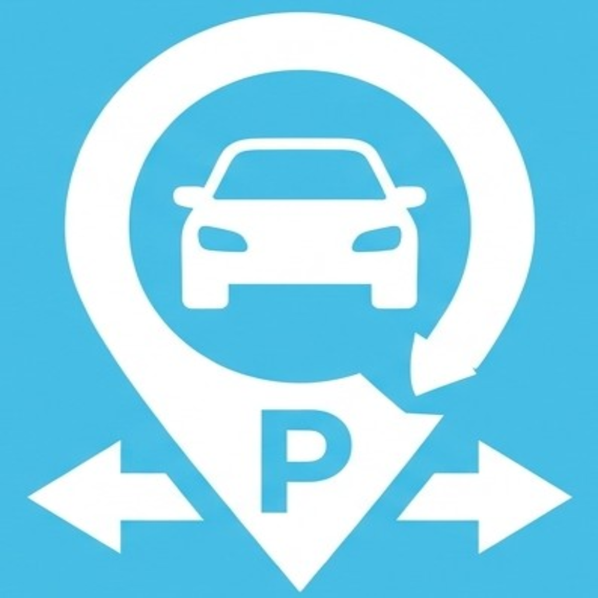
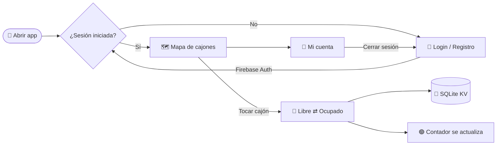

<div align="center">



# 🅿️ SmartPark

**Encuentra lugar sin dar vueltas.**
App móvil para ver y administrar en tiempo real los cajones disponibles de un estacionamiento.

<br />


</div>

---

## 📋 Tabla de contenido

- [¿Qué es SmartPark?](#-qué-es-smartpark)
- [Funciones](#-funciones)
- [Tecnologías](#️-tecnologías)
- [Cómo funciona](#-cómo-funciona)
- [Empezar](#-empezar)
- [Generar el APK](#-generar-el-apk)
- [Estructura del proyecto](#-estructura-del-proyecto)
- [Scripts](#-scripts)
- [Hoja de ruta](#️-hoja-de-ruta)

---

## 🚗 ¿Qué es SmartPark?

**SmartPark** muestra el estacionamiento como un mapa de cajones sobre asfalto. De un vistazo sabes cuántos lugares quedan libres y dónde están. Al tocar un cajón cambia de **libre** a **ocupado**: un carrito entra animado al lugar y el contador se actualiza al momento.

> 🎯 **Objetivo:** reducir el tiempo que se pierde buscando dónde estacionarse.

---

## ✨ Funciones

| | Función | Detalle |
|:-:|---|---|
| 🔐 | **Cuentas de usuario** | Registro e inicio de sesión con correo y contraseña (Firebase Authentication). |
| 🛡️ | **Rutas protegidas** | Si no has iniciado sesión, la app te manda al login. |
| 🗺️ | **Mapa de cajones** | 20 lugares en 2 filas que se ajustan al ancho de cualquier pantalla. |
| 🟢 | **Contador en vivo** | "X de 20 lugares disponibles", con un pequeño rebote cada vez que cambia. |
| 🚙 | **Animaciones** | Los carros entran y salen del cajón; los botones responden al toque. |
| 💾 | **Guarda el estado** | Los cajones se conservan aunque cierres la app (SQLite KV Store). |
| 🌗 | **Modo claro y oscuro** | Sigue el tema del teléfono. |
| 🗣️ | **En español** | Mensajes de error claros ("Correo o contraseña incorrectos", "Sin conexión"…). |

---

## 🛠️ Tecnologías

<div align="center">

| Capa | Herramienta |
|---|---|
| Framework | [Expo SDK 58](https://docs.expo.dev/) + [React Native 0.88](https://reactnative.dev/) |
| Lenguaje | TypeScript |
| Navegación | [Expo Router](https://docs.expo.dev/router/introduction/) (rutas por archivos, *typed routes*) |
| Autenticación | [Firebase Auth](https://firebase.google.com/docs/auth) |
| Almacenamiento local | `expo-sqlite/kv-store` |
| Animaciones | React Native Animated + Reanimated |
| Builds | [EAS Build](https://docs.expo.dev/build/introduction/) |

</div>

---

## 🔄 Cómo funciona



---

## 🚀 Empezar

### Requisitos

- [Node.js](https://nodejs.org/) 20 o más reciente
- Un teléfono **Android** o un emulador de Android Studio
- Un proyecto en [Firebase](https://console.firebase.google.com/) con **Authentication → Correo/contraseña** activado

### 1. Clonar e instalar

```bash
git clone https://github.com/Ciitreck/SmartPark.git
cd SmartPark
npm install
```

### 2. Configurar Firebase

Copia el archivo de ejemplo y llena los valores desde
**Consola de Firebase → Configuración del proyecto → Tus apps → App web**:

```bash
cp .env.example .env.local
```

```env
EXPO_PUBLIC_FIREBASE_API_KEY=tu_api_key
EXPO_PUBLIC_FIREBASE_APP_ID=tu_app_id
# ...el resto ya viene lleno
```

> ⚠️ `.env.local` está en `.gitignore`. Nunca lo subas al repositorio.

### 3. Correr la app

```bash
npx expo start
```

Luego presiona **`a`** para abrirla en Android, o **`w`** para verla en el navegador.

---

## 📦 Generar el APK

El proyecto ya tiene perfiles de [EAS Build](https://docs.expo.dev/build/introduction/) en `eas.json`:

| Perfil | Para qué sirve | Resultado |
|---|---|---|
| `development` | Desarrollo con recarga en vivo | Build de desarrollo |
| `preview` | Instalar y probar en cualquier Android | **`.apk`** |
| `production` | Publicar en Google Play | `.aab` |

```bash
npx eas-cli@latest build --platform android --profile preview
```

Al terminar, EAS te da un enlace y un código QR para descargar el APK directo en el teléfono.

---

## 📁 Estructura del proyecto

```text
SmartPark/
├── assets/images/          # Ícono, splash y logo
├── src/
│   ├── app/                # Pantallas (Expo Router)
│   │   ├── (tabs)/
│   │   │   ├── index.tsx   # 🗺️ Mapa del estacionamiento
│   │   │   └── account.tsx # 👤 Mi cuenta
│   │   ├── login.tsx       # 🔐 Iniciar sesión
│   │   ├── register.tsx    # ✍️ Crear cuenta
│   │   └── _layout.tsx     # Rutas protegidas
│   ├── components/         # Mapa, cajón, carro, formularios…
│   ├── constants/          # Distribución de cajones y tema
│   ├── context/auth.tsx    # Estado de sesión
│   ├── hooks/              # Tema y animaciones
│   └── lib/                # Firebase, auth y guardado local
├── app.json                # Configuración de Expo
└── eas.json                # Perfiles de build
```

---

## 📜 Scripts

| Comando | Qué hace |
|---|---|
| `npm start` | Inicia el servidor de desarrollo |
| `npm run android` | Compila y abre la app en Android |
| `npm run web` | Abre la app en el navegador |
| `npm run lint` | Revisa el código con ESLint |

---

## 🗺️ Hoja de ruta

- [x] Registro e inicio de sesión con Firebase
- [x] Rutas protegidas
- [x] Mapa de cajones con animaciones
- [x] Guardar el estado de los cajones en el teléfono
- [ ] Sincronizar los cajones en la nube para todos los usuarios
- [ ] Varios estacionamientos y niveles
- [ ] Reservar un lugar
- [ ] Integración con sensores físicos de ocupación
- [ ] Publicar en Google Play

---

<div align="center">

Hecho con 💙 por **[Ciitreck](https://github.com/Ciitreck)**

<sub>🅿️ SmartPark · Estaciónate más rápido</sub>

</div>
