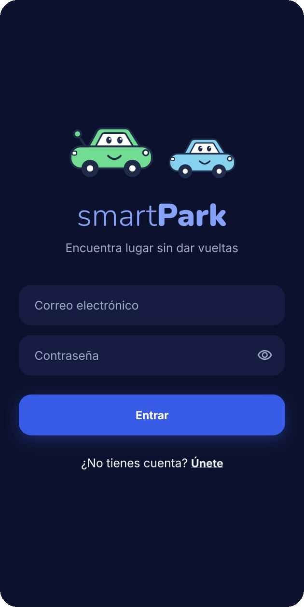
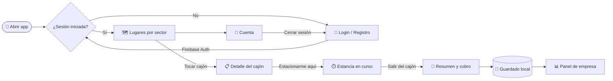

<div align="center">


# 🅿️ SmartPark

**Encuentra lugar sin dar vueltas.**
App móvil para ver y administrar en tiempo real los cajones disponibles de un estacionamiento.

<br />


<br />
<br />

<a href="https://github.com/Ciitreck/SmartPark/releases/latest">
  
</a>

<sub>Descarga el archivo <code>.apk</code> de la última versión e instálalo en tu teléfono Android.</sub>

</div>

---

## 📋 Tabla de contenido

- [¿Qué es SmartPark?](#-qué-es-smartpark)
- [Capturas](#-capturas)
- [Funciones](#-funciones)
- [Tecnologías](#️-tecnologías)
- [Cómo funciona](#-cómo-funciona)
- [Empezar](#-empezar)
- [Generar el APK](#-generar-el-apk)
- [Estructura del proyecto](#-estructura-del-proyecto)
- [Scripts](#-scripts)
- [Hoja de ruta](#️-hoja-de-ruta)

---

## 🚗 ¿Qué es SmartPark?

**SmartPark** muestra el estacionamiento como un mapa de cajones dividido en sectores. De un vistazo sabes cuántos lugares quedan libres y dónde están. Eliges un cajón, te estacionas y la app lleva la cuenta de tu tiempo y de lo que vas a pagar. Para la empresa hay un panel con la ocupación y los cobros del día.

> 🎯 **Objetivo:** reducir el tiempo que se pierde buscando dónde estacionarse.

---

## 📸 Capturas

<div align="center">

| 🔐 Inicio de sesión |
|:-:|
|  |

</div>

---

## ✨ Funciones

| | Función | Detalle |
|:-:|---|---|
| 🔐 | **Cuentas de usuario** | Registro e inicio de sesión con correo y contraseña (Firebase Authentication). |
| 🛡️ | **Rutas protegidas** | Si no has iniciado sesión, la app te manda al login. |
| 🗺️ | **Mapa por sectores** | 30 cajones en 3 sectores (A, B y C). Al abrir, te muestra el sector con más lugares libres. |
| 🚦 | **Estados del cajón** | Libre, ocupado, reservado (discapacidad o preferente), tiempo excedido y sin señal del sensor. |
| 📋 | **Detalle del cajón** | Una hoja inferior con número, sector, tiempo y costo acumulado, y el botón **"Estacionarme aquí"**. |
| ⏱️ | **Tu estancia** | Cronómetro en vivo de cuánto llevas estacionado y un resumen con el total al salir. |
| 💵 | **Tarifa** | Las primeras 2 h son gratis; después, $15 MXN por hora o fracción. |
| 📊 | **Panel de empresa** | Ocupación general y por área, tiempo promedio, cobros del día, lo que falta por cobrar y cajones sin señal. |
| 🚙 | **Animaciones suaves** | Carros que entran y salen del cajón, una mascota y transiciones cortas sin rebote. |
| 💾 | **Guarda el estado** | Cajones, tu estancia y el historial se conservan aunque cierres la app. |
| 🌗 | **Modo claro y oscuro** | Design system propio con tipografías Nunito e Inter. |
| 🗣️ | **En español** | Mensajes de error claros ("Correo o contraseña incorrectos", "Sin conexión"…). |

---

## 🛠️ Tecnologías

<div align="center">

| Capa | Herramienta |
|---|---|
| Framework | [Expo SDK 58](https://docs.expo.dev/) + [React Native 0.88](https://reactnative.dev/) |
| Lenguaje | TypeScript |
| Navegación | [Expo Router](https://docs.expo.dev/router/introduction/) (rutas por archivos, *typed routes*) |
| Autenticación | [Firebase Auth](https://firebase.google.com/docs/auth) |
| Almacenamiento local | `expo-sqlite/kv-store` (Android) · `localStorage` (web) |
| Diseño | Design system propio, tipografías Nunito + Inter, `react-native-svg` |
| Animaciones | React Native Animated + Reanimated |
| Builds | [EAS Build](https://docs.expo.dev/build/introduction/) |

</div>

---

## 🔄 Cómo funciona



---

## 🚀 Empezar

### Requisitos

- [Node.js](https://nodejs.org/) 20 o más reciente
- Un teléfono **Android** o un emulador de Android Studio
- Un proyecto en [Firebase](https://console.firebase.google.com/) con **Authentication → Correo/contraseña** activado

### 1. Clonar e instalar

```bash
git clone https://github.com/Ciitreck/SmartPark.git
cd SmartPark
npm install
```

### 2. Configurar Firebase

Copia el archivo de ejemplo y llena los valores desde
**Consola de Firebase → Configuración del proyecto → Tus apps → App web**:

```bash
cp .env.example .env.local
```

```env
EXPO_PUBLIC_FIREBASE_API_KEY=tu_api_key
EXPO_PUBLIC_FIREBASE_APP_ID=tu_app_id
# ...el resto ya viene lleno
```

> ⚠️ `.env.local` está en `.gitignore`. Nunca lo subas al repositorio.

### 3. Correr la app

```bash
npx expo start
```

Luego presiona **`a`** para abrirla en Android, o **`w`** para verla en el navegador.

---

## 📦 Generar el APK

El proyecto ya tiene perfiles de [EAS Build](https://docs.expo.dev/build/introduction/) en `eas.json`:

| Perfil | Para qué sirve | Resultado |
|---|---|---|
| `development` | Desarrollo con recarga en vivo | Build de desarrollo |
| `preview` | Instalar y probar en cualquier Android | **`.apk`** |
| `production` | Publicar en Google Play | `.aab` |

```bash
npx eas-cli@latest build --platform android --profile preview
```

Al terminar, EAS te da un enlace y un código QR para descargar el APK directo en el teléfono.

---

## 📁 Estructura del proyecto

```text
SmartPark/
├── assets/images/          # Ícono, splash y logo
├── src/
│   ├── app/                # Pantallas (Expo Router)
│   │   ├── (tabs)/
│   │   │   ├── index.tsx   # 🗺️ Lugares por sector
│   │   │   ├── stay.tsx    # ⏱️ Tu estancia y cobro
│   │   │   ├── panel.tsx   # 📊 Panel de empresa
│   │   │   └── account.tsx # 👤 Mi cuenta
│   │   ├── login.tsx       # 🔐 Iniciar sesión
│   │   ├── register.tsx    # ✍️ Crear cuenta
│   │   └── _layout.tsx     # Rutas protegidas
│   ├── components/         # Mapa, cajón, hoja de detalle, formularios…
│   │   └── ui/             # Design system: botón, tarjeta, cronómetro, mascota…
│   ├── constants/          # Sectores, cajones y tema
│   ├── context/            # Sesión y estado del estacionamiento
│   ├── hooks/              # Tema, teclado, reloj y animaciones
│   └── lib/                # Firebase, auth, tarifas y guardado local
├── app.json                # Configuración de Expo
└── eas.json                # Perfiles de build
```

---

## 📜 Scripts

| Comando | Qué hace |
|---|---|
| `npm start` | Inicia el servidor de desarrollo |
| `npm run android` | Compila y abre la app en Android |
| `npm run web` | Abre la app en el navegador |
| `npm run lint` | Revisa el código con ESLint |

---

## 🗺️ Hoja de ruta

- [x] Registro e inicio de sesión con Firebase
- [x] Rutas protegidas
- [x] Mapa de cajones con animaciones
- [x] Guardar el estado de los cajones en el teléfono
- [x] Sectores y niveles
- [x] Estancia con cronómetro y tarifa
- [x] Panel de empresa
- [ ] Sincronizar los cajones en la nube para todos los usuarios
- [ ] Reservar un lugar
- [ ] Integración con sensores físicos de ocupación (Arduino)
- [ ] Publicar en Google Play

---

<div align="center">

Hecho con 💙 por **[Ciitreck](https://github.com/Ciitreck)**

<sub>🅿️ SmartPark · Estaciónate más rápido</sub>

</div>
